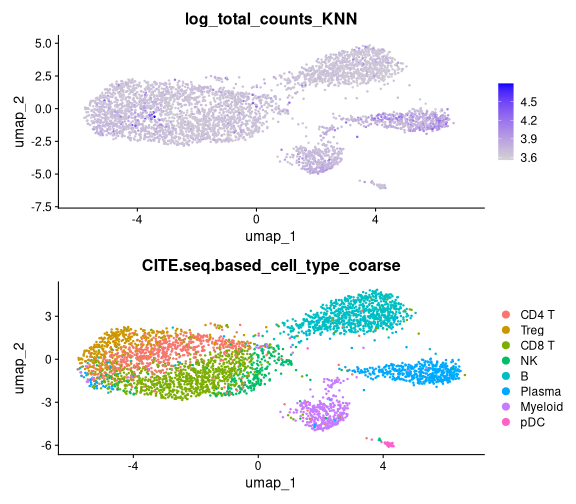

This tutorial is the R counterpart of the
[tutorial of the Python package](https://knn-normalization.readthedocs.io): it has the same
content, but uses Seurat objects instead of `MuData` and `AnnData` objects.
It is precomputed, since the data is not part of the package.

## Loading packages


``` r
library(KNN.normalization)
library(Seurat)
library(ggplot2)
```

## Loading the data

We use our Immune Colon data for this tutorial (SAY HOW TO DOWNLOAD IT). It is distributed as a
Seurat object (the Python tutorial uses the equivalent `.h5ad` files).


``` r
DATA_DIR <- "/groups/nils/members/javier/KNN_normalization_paper_code"
seurat_object <- readRDS(file.path(DATA_DIR, "Immune_colon_seurat.rds"))
```


``` r
seurat_object
#> An object of class Seurat 
#> 25215 features across 4075 samples within 2 assays 
#> Active assay: RNA (25154 features, 0 variable features)
#>  4 layers present: counts, cellranger_counts, normalized_and_log, soupX_counts
#>  1 other assay present: ADT
#>  4 dimensional reductions calculated: umap_protein, umap_rna, cytovi, umap_cytovi
```

The object has two assays, `RNA` and `ADT` (protein), for the same 4075 cells. Besides the raw
counts, it contains some extra layers that we do not need in this tutorial, so we keep only the
`counts` layer of each assay.


``` r
seurat_object <- DietSeurat(seurat_object, layers = "counts")
seurat_object
#> An object of class Seurat 
#> 25215 features across 4075 samples within 2 assays 
#> Active assay: RNA (25154 features, 0 variable features)
#>  1 layer present: counts
#>  1 other assay present: ADT
```


``` r
LayerData(seurat_object, assay = "ADT", layer = "counts")[1:5, 1:5]
#> 5 x 5 sparse Matrix of class "dgCMatrix"
#>        AAACGGGCACAACGCC-p026n_TS AAAGATGTCTTGAGAC-p026n_TS
#> CD19                          17                        91
#> CD33                           9                         8
#> CD11c                         34                        34
#> CD10                          52                        51
#> CD45RA                        11                        16
#>        AAAGCAACACCGTTGG-p026n_TS AAAGCAAGTAGCTCCG-p026n_TS
#> CD19                          18                        18
#> CD33                           8                        13
#> CD11c                         39                        29
#> CD10                          53                        61
#> CD45RA                        18                        23
#>        AACACGTAGCAGACTG-p026n_TS
#> CD19                           9
#> CD33                           9
#> CD11c                         40
#> CD10                          59
#> CD45RA                        24
```

The `counts` layer of the `ADT` assay consists of raw counts, as is expected by KNN normalization.
KNN normalization reads the raw counts from the `counts` layer of both assays. Seurat stores
features x cells (AnnData stores cells x features).

If you have your own data, any Seurat object with an `RNA` and an `ADT` assay and raw counts in the
`counts` layers works. Keep a copy of the untouched object for the later sections of this tutorial
(in R, this is free until one of the copies is modified):


``` r
original_object <- seurat_object
```

## Running KNN normalization with a Seurat object (using neighbors from RNA)

### Run KNN normalization on the Seurat object, using `calculate_neighbors_from = "rna"`

Unlike in Python, where the object is modified in place, in R we assign the result.


``` r
seurat_object <- knn_normalize(seurat_object, calculate_neighbors_from = "rna")
#> Calculating KNN graph from RNA data
#> Running KNN normalization
#> Iteration 1
#> Iteration 2
#> Change wrt previous iteration: 4.39017273066261
#> Iteration 3
#> Change wrt previous iteration: 0.171061632506075
#> Iteration 4
#> Change wrt previous iteration: 0.030077138367171
#> Iteration 5
#> Change wrt previous iteration: 0.0172190020849484
#> Iteration 6
#> Change wrt previous iteration: 0.0115302411330591
#> Iteration 7
#> Change wrt previous iteration: 0.00836285678830451
#> Iteration 8
#> Change wrt previous iteration: 0.00617653899726878
#> Iteration 9
#> Change wrt previous iteration: 0.00466395198717184
#> Iteration 10
#> Change wrt previous iteration: 0.00362163536319837
#> Iteration 11
#> Change wrt previous iteration: 0.00287262667407195
#> Iteration 12
#> Change wrt previous iteration: 0.00237922486793973
#> Iteration 13
#> Change wrt previous iteration: 0.00199631787481547
#> Iteration 14
#> Change wrt previous iteration: 0.00169185900371516
#> Iteration 15
#> Change wrt previous iteration: 0.00144656391719611
#> Iteration 16
#> Change wrt previous iteration: 0.00124254125762469
#> Iteration 17
#> Change wrt previous iteration: 0.00107107057754496
#> Iteration 18
#> Change wrt previous iteration: 0.000935682354099798
#> Iteration 19
#> Change wrt previous iteration: 0.000835720665155359
#> Iteration 20
#> Change wrt previous iteration: 0.000744686915101322
#> Iteration 21
#> Change wrt previous iteration: 0.000662202019433678
#> Iteration 22
#> Change wrt previous iteration: 0.000587797152562297
#> Iteration 23
#> Change wrt previous iteration: 0.000520944614397223
#> Iteration 24
#> Change wrt previous iteration: 0.000461084375664389
```

The normalized protein data is in the `data` layer of the `ADT` assay (the raw counts in the
`counts` layer are untouched):


``` r
LayerData(seurat_object, assay = "ADT", layer = "data")[1:5, 1:5]
#>        AAACGGGCACAACGCC-p026n_TS AAAGATGTCTTGAGAC-p026n_TS
#> CD19                    3.053979                  4.608481
#> CD33                    2.601994                  2.609082
#> CD11c                   3.626498                  3.707694
#> CD10                    4.005988                  4.069484
#> CD45RA                  2.735525                  3.088655
#>        AAAGCAACACCGTTGG-p026n_TS AAAGCAAGTAGCTCCG-p026n_TS
#> CD19                    3.376165                  3.112775
#> CD33                    2.805620                  2.867653
#> CD11c                   4.024860                  3.503641
#> CD10                    4.301114                  4.166936
#> CD45RA                  3.376165                  3.309485
#>        AACACGTAGCAGACTG-p026n_TS
#> CD19                    2.411647
#> CD33                    2.411647
#> CD11c                   3.579252
#> CD10                    3.931473
#> CD45RA                  3.139886
```

The `knn_normalize` function expects raw counts in protein and RNA, since by default it
normalizes and log-transforms the RNA data before calculating the KNN graph from the RNA data.
If you want to use KNN normalization with already-processed data, see the section
"Running KNN normalization on a user-computed KNN graph".

If you don't want to print progress messages, pass `verbose = FALSE`.

### Downstream analysis

We generally recommend to z-score (scale) the data per protein. Since we have several samples, we
do the scaling per sample, which will additionally partly integrate the data. In Seurat, the
scaled data goes to its own layer, so (unlike in Python) the KNN-normalized values in the `data`
layer are not overwritten and we do not need to keep a copy.


``` r
DefaultAssay(seurat_object) <- "ADT"
seurat_object <- ScaleData(
  seurat_object,
  features = rownames(seurat_object),
  split.by = "sample", # scale each protein to zero mean and unit variance, separately for each sample
  scale.max = Inf # do not clip the scaled values
)
#> Centering and scaling data matrix
#> Centering and scaling data from split p026n
#> Centering and scaling data from split p026t
#> Centering and scaling data from split p035n
#> Centering and scaling data from split p035t
#> Centering and scaling data from split p042t
#> Centering and scaling data from split p046n
#> Centering and scaling data from split p046t
# PCA is only useful for large antibody panels (more than ~50 proteins)
seurat_object <- RunPCA(seurat_object, features = rownames(seurat_object), npcs = 50, verbose = FALSE)
seurat_object <- FindNeighbors(seurat_object, dims = 1:50, k.param = 15, verbose = FALSE)
seurat_object <- RunUMAP(seurat_object, dims = 1:50, verbose = FALSE)
```


``` r
# Total counts per cell after KNN normalization: undo the log, sum over proteins, take log10
knn_counts <- exp(LayerData(seurat_object, assay = "ADT", layer = "data"))
seurat_object$log_total_counts_KNN <- log10(colSums(knn_counts))
```


``` r
FeaturePlot(seurat_object, features = "log_total_counts_KNN") +
  DimPlot(seurat_object, group.by = "CITE-seq-based_cell_type_coarse")
```



KNN normalization largely removed total count differences within cell types and preserved
differences in total counts between cell types (plasma cells tend to have higher total counts).

## Running KNN normalization with only protein data (using neighbors from protein)

A Seurat object with only the protein assay works too, with `calculate_neighbors_from = "prot"`.


``` r
prot_object <- original_object
DefaultAssay(prot_object) <- "ADT"
prot_object <- DietSeurat(prot_object, assays = "ADT", layers = "counts")
prot_object <- knn_normalize(prot_object, calculate_neighbors_from = "prot")
#> Calculating KNN graph from protein data
#> Running KNN normalization
#> Iteration 1
#> Iteration 2
#> Change wrt previous iteration: 3.33104776720713
#> Iteration 3
#> Change wrt previous iteration: 0.172935244375144
#> Iteration 4
#> Change wrt previous iteration: 0.0478617678515232
#> Iteration 5
#> Change wrt previous iteration: 0.0194480334510289
#> Iteration 6
#> Change wrt previous iteration: 0.0104446721830436
#> Iteration 7
#> Change wrt previous iteration: 0.00831789637127889
#> Iteration 8
#> Change wrt previous iteration: 0.00655167365344944
#> Iteration 9
#> Change wrt previous iteration: 0.00510445798338499
#> Iteration 10
#> Change wrt previous iteration: 0.00396671810619198
#> Iteration 11
#> Change wrt previous iteration: 0.00308378587523417
#> Iteration 12
#> Change wrt previous iteration: 0.00241373351971874
#> Iteration 13
#> Change wrt previous iteration: 0.00189533853355695
#> Iteration 14
#> Change wrt previous iteration: 0.00149226776764122
#> Iteration 15
#> Change wrt previous iteration: 0.00117701496911349
#> Iteration 16
#> Change wrt previous iteration: 0.00100624054512011
#> Iteration 17
#> Change wrt previous iteration: 0.000925947965871865
#> Iteration 18
#> Change wrt previous iteration: 0.000853905453444881
#> Iteration 19
#> Change wrt previous iteration: 0.000788996964213418
#> Iteration 20
#> Change wrt previous iteration: 0.000730326045038421
#> Iteration 21
#> Change wrt previous iteration: 0.000677146960779806
#> Iteration 22
#> Change wrt previous iteration: 0.000628826141032102
#> Iteration 23
#> Change wrt previous iteration: 0.000584818534653975
#> Iteration 24
#> Change wrt previous iteration: 0.000544651654932116
#> Iteration 25
#> Change wrt previous iteration: 0.000507913880983146
```


``` r
LayerData(prot_object, assay = "ADT", layer = "data")[1:5, 1:5]
#>        AAACGGGCACAACGCC-p026n_TS AAAGATGTCTTGAGAC-p026n_TS
#> CD19                    3.151574                  4.637991
#> CD33                    2.699589                  2.638592
#> CD11c                   3.724093                  3.737204
#> CD10                    4.103583                  4.098995
#> CD45RA                  2.833120                  3.118165
#>        AAAGCAACACCGTTGG-p026n_TS AAAGCAAGTAGCTCCG-p026n_TS
#> CD19                    3.418587                  3.133407
#> CD33                    2.848042                  2.888284
#> CD11c                   4.067282                  3.524273
#> CD10                    4.343536                  4.187567
#> CD45RA                  3.418587                  3.330117
#>        AACACGTAGCAGACTG-p026n_TS
#> CD19                    2.492569
#> CD33                    2.492569
#> CD11c                   3.660174
#> CD10                    4.012395
#> CD45RA                  3.220808
```

## Running KNN normalization on a user-computed KNN graph

Let's say you want to run KNN normalization but use your own KNN graph built with your own
favorite method and data. This is only recommended if you think your KNN graph is more precise
than our default KNN graph building procedure.

As an example, we normalize, log-transform, select 2000 HVGs and run PCA on the RNA data and use
20 PCs to calculate RNA neighbors.


``` r
prot_object <- original_object
```


``` r
DefaultAssay(prot_object) <- "RNA"
# Split the RNA layers by sample, so that the HVGs are selected taking the samples into account
prot_object[["RNA"]] <- split(prot_object[["RNA"]], f = prot_object$sample)
prot_object <- NormalizeData(prot_object, verbose = FALSE)
prot_object <- FindVariableFeatures(prot_object, nfeatures = 2000, verbose = FALSE)
prot_object <- ScaleData(prot_object, verbose = FALSE)
prot_object <- RunPCA(prot_object, npcs = 20, verbose = FALSE)
prot_object <- FindNeighbors(prot_object, dims = 1:20, k.param = 15, verbose = FALSE)
prot_object[["RNA"]] <- JoinLayers(prot_object[["RNA"]])
Graphs(prot_object)
#> [1] "RNA_nn"  "RNA_snn"
```

The KNN graph (`RNA_nn`) lives in the same Seurat object as the protein data, so, unlike in
Python, we do not need to transfer it between objects. We perform KNN normalization with the
existing neighbors.


``` r
prot_object <- knn_normalize(
  prot_object,
  calculate_neighbors_from = "use_existing_neighbors",
  graph_name = "RNA_nn"
)
#> Running KNN normalization
#> Iteration 1
#> Iteration 2
#> Change wrt previous iteration: 5.04451660351638
#> Iteration 3
#> Change wrt previous iteration: 0.505920379069551
#> Iteration 4
#> Change wrt previous iteration: 0.0949527765478588
#> Iteration 5
#> Change wrt previous iteration: 0.0420764161548333
#> Iteration 6
#> Change wrt previous iteration: 0.0270337520006947
#> Iteration 7
#> Change wrt previous iteration: 0.0190474375220344
#> Iteration 8
#> Change wrt previous iteration: 0.0130632229373104
#> Iteration 9
#> Change wrt previous iteration: 0.00935806592345978
#> Iteration 10
#> Change wrt previous iteration: 0.00684451671094743
#> Iteration 11
#> Change wrt previous iteration: 0.00515944332969931
#> Iteration 12
#> Change wrt previous iteration: 0.00396237504514252
#> Iteration 13
#> Change wrt previous iteration: 0.00307426689399315
#> Iteration 14
#> Change wrt previous iteration: 0.00243965114003031
#> Iteration 15
#> Change wrt previous iteration: 0.00214233453643264
#> Iteration 16
#> Change wrt previous iteration: 0.00187167670250143
#> Iteration 17
#> Change wrt previous iteration: 0.00162919933850469
#> Iteration 18
#> Change wrt previous iteration: 0.00141435320953009
#> Iteration 19
#> Change wrt previous iteration: 0.00122551545689709
#> Iteration 20
#> Change wrt previous iteration: 0.00106050164282623
#> Iteration 21
#> Change wrt previous iteration: 0.000916917139830109
#> Iteration 22
#> Change wrt previous iteration: 0.000794441807408619
#> Iteration 23
#> Change wrt previous iteration: 0.000733707585689691
#> Iteration 24
#> Change wrt previous iteration: 0.000673563275877864
#> Iteration 25
#> Change wrt previous iteration: 0.000615229941339335
```


``` r
LayerData(prot_object, assay = "ADT", layer = "data")[1:5, 1:5]
#>        AAACGGGCACAACGCC-p026n_TS AAAGATGTCTTGAGAC-p026n_TS
#> CD19                    2.628574                  4.563414
#> CD33                    2.176589                  2.564015
#> CD11c                   3.201093                  3.662627
#> CD10                    3.580583                  4.024417
#> CD45RA                  2.310120                  3.043588
#>        AAAGCAACACCGTTGG-p026n_TS AAAGCAAGTAGCTCCG-p026n_TS
#> CD19                    2.994289                  2.734612
#> CD33                    2.423745                  2.489489
#> CD11c                   3.642985                  3.125478
#> CD10                    3.919238                  3.788772
#> CD45RA                  2.994289                  2.931322
#>        AACACGTAGCAGACTG-p026n_TS
#> CD19                    2.004652
#> CD33                    2.004652
#> CD11c                   3.172257
#> CD10                    3.524478
#> CD45RA                  2.732890
```
